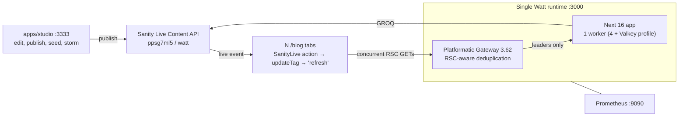

# Gateway dedup POC: surviving the Next.js `router.refresh()` stampede

A self-contained proof of concept showing that [Platformatic Gateway](https://docs.platformatic.dev/docs/reference/gateway/overview) request deduplication shields a self-hosted Next.js 16 app from the `router.refresh()` prefetch stampede described in [vercel/next.js#93210](https://github.com/vercel/next.js/issues/93210) — with **no application-code changes**.

One Watt runtime on `:3000` runs the gateway (entrypoint) in front of a Next 16 blog backed by real [Sanity Live](https://www.sanity.io/docs/content-lake/live-content-api) content. A Sanity Studio on `:3333` mutates that content. Every publish makes every connected browser refresh and eagerly re-prefetch every in-viewport link at once; the gateway collapses each wave of identical concurrent requests to ~1 upstream request per unique RSC payload.

## The problem

Next.js 16 changed `router.refresh()`: where v15 marked in-viewport `<Link>` prefetches _stale_ and waited for user intent, v16 **eagerly refetches all of them immediately**. Combined with links issuing multiple segment prefetches, a single CMS-driven refresh notification fans out to `N clients × L links × S segments` concurrent requests.

Production impact reported in [next.js#93210](https://github.com/vercel/next.js/issues/93210) for `www.sanity.io` after upgrading to Next 16: daily ISR writes grew from **7.1M to 358.5M** (single-day peak 1.52B); the read/write ratio flipped from ~3:1 to ~1:5; disabling `<Link>` prefetching removed the spike. [`experimental.prefetchInlining`](https://github.com/vercel/next.js/pull/84958) reduces the segment multiplier and an upstream fix is in progress ([#93511](https://github.com/vercel/next.js/pull/93511), unmerged at the time of writing), but the eager wave ships in every current Next 16 release.

The exact trigger is the Sanity Live pattern, but any stack that broadcasts an invalidation to many browsers and calls `router.refresh()` behaves the same. This POC does not fix the browser behavior — it shows the origin can defend itself.

## The defense

[Gateway request deduplication](https://docs.platformatic.dev/docs/reference/gateway/deduplication) (Platformatic 3.62+, prototyped on [platformatic/nextjs-repro-router.refresh-v16-regression#dedupe-in-gateway](https://github.com/platformatic/nextjs-repro-router.refresh-v16-regression/tree/dedupe-in-gateway)): the first request for a key becomes the **leader** and is proxied upstream (response streamed to its client while being buffered); concurrent matching requests become **waiters** and **replay** the leader's response without ever reaching Next.



## Quick start

Requirements: [pnpm](https://pnpm.io) ≥ 10 (the repo pins `pnpm@11.15.1` via `packageManager`; pnpm auto-provisions **Node 24** through `devEngines.runtime` with `onFail: download` — no manual Node install needed).

```sh
pnpm install
pnpm dev            # builds Next, starts Watt (gateway + Next) on :3000 and Studio on :3333
```

The dataset `ppsg7ml5/watt` is public and pre-seeded, so the blog renders immediately. To mutate content you need write access:

- **Studio**: log in at `http://localhost:3333` (see [AGENTS.md](./AGENTS.md) for the hash-token flow used by agents: `http://localhost:3333#token=$STUDIO_AUTH_TOKEN`), then use the **Load test** tool (seed / single publish / mutation storm / cleanup) or edit any post and publish.
- **Headless**: `STUDIO_AUTH_TOKEN=... pnpm seed` (idempotent, 24 posts) and `STUDIO_AUTH_TOKEN=... pnpm mutate` (single publish-style patch).

Other entry points:

| Command                     | Purpose                                                                                                      |
| --------------------------- | ------------------------------------------------------------------------------------------------------------ |
| `pnpm dev`                  | Default profile: dedup on, memory storage, 1 Next worker                                                     |
| `pnpm dev:no-dedup`         | Same topology, deduplication disabled                                                                        |
| `pnpm dev:valkey`           | Scale-out profile: Valkey dedup storage + shared Next cache, 4 workers (needs `docker compose up -d valkey`) |
| `pnpm herd`                 | Synthetic 200-request RSC wave + measurement table                                                           |
| `pnpm lint` / `pnpm format` | `oxlint --type-check` (TS 6 via tsgolint) / `oxfmt`                                                          |

`pnpm dev` runs Next in **production mode** on purpose: `next dev` disables automatic `<Link>` prefetching, which is the very behavior under test.

## The synthetic proof: `pnpm herd`

`scripts/herd.mjs` fires N byte-identical RSC GETs (the shape of a refresh-wave request) released through a synchronization barrier — the worst-case instant of a stampede — then reads baseline-relative Prometheus deltas from the gateway-owned `/api/stats`:

Measured on this repo (200 concurrent `GET /blog?_rsc`, single gateway worker):

| Measurement                | Dedup on | Dedup off |
| -------------------------- | -------: | --------: |
| Client requests            |      200 |       200 |
| Successful responses (200) |      200 |       200 |
| **Requests reaching Next** |    **1** |   **200** |
| Leaders                    |        1 |         0 |
| Waiters                    |      199 |         0 |
| Replays                    |      199 |         0 |
| Fallbacks / skips / errors |        0 |         0 |
| Wall time                  |  ~150 ms |   ~330 ms |

The Valkey storage profile produces the same collapse (1 request reaching Next) while sharing lock/replay state across workers and instances.

## The end-to-end proof: publish in the Studio

1. `pnpm dev`, open a few tabs of `http://localhost:3000/blog`, scroll the grid into view.
2. Publish a post in the Studio (or press **Single publish mutation** / **Start mutation storm** in the Load test tool).
3. Sanity Live notifies every tab → the custom eager action runs `updateTag(tag)` for each invalidated tag and returns `'refresh'` → every tab calls `router.refresh()` → each tab refetches the page **and eagerly re-prefetches every in-viewport link**.
4. The stats strip on `/blog` (fed by `/api/stats`) shows the wave: requests reaching Next, leaders, waiters, replays, skips. Content updates live in all tabs.

Measured browser waves from a single publish (24 in-viewport links per tab, this VM):

| Scenario                                            |          Requests reaching Next |
| --------------------------------------------------- | ------------------------------: |
| 3 tabs, next `16.2.4`, dedup off                    |               **201** (~67/tab) |
| 3 tabs, next `16.3.0-preview.6`, dedup off          |                **97** (~32/tab) |
| 3 tabs, next `16.3.0-preview.6`, dedup on           |      55 (53 leaders, 9 waiters) |
| 6 tabs, next `16.3.0-preview.6`, dedup off          |                             157 |
| 6 tabs, next `16.3.0-preview.6`, dedup on           |                  156 (1 waiter) |
| 6 tabs, preview, dedup on, 4 workers + Valkey cache | 288, all tabs update coherently |

Two honest observations, which the herd numbers complement:

- **The regression reproduces on both versions.** One publish with three viewers costs the origin ~100–200 requests within ~2 seconds. `16.3.0-preview.6` roughly halves the multiplier vs `16.2.4` (better segment-prefetch batching) but the eager wave is still there, so the preview stays this repo's default.
- **Deduplication coalesces _concurrent_ identical requests — it is not a cache.** A waiter only replays a response whose leader is still in flight (or just stored, within `ttl`, while contended). On this VM the app renders in ~30 ms and a handful of local tabs spread their wave over ~2 s, so browser waves rarely overlap and dedup barely engages (150+ leaders, 1 waiter). Under real stampede conditions — thousands of clients notified simultaneously, production render times — arrival density is orders of magnitude higher, which is exactly the regime the herd measures: every concurrent duplicate collapses onto one leader. Between those bounds, the collapse factor scales with (clients × render time) / wave spread.

Also note what "requests reaching Next" costs even when cached: with dedup off, Next parses, routes and serves 200 HTTP requests even if only one of them re-renders — event-loop and socket pressure the gateway absorbs entirely.

## How the dedup is configured

[`apps/gateway/watt.json`](apps/gateway/watt.json) uses the native `gateway.deduplication` (no custom proxy logic — the PO's prototype [`dedupe-handler.js`](https://github.com/platformatic/nextjs-repro-router.refresh-v16-regression/blob/dedupe-in-gateway/apps/gateway/dedupe-handler.js) shipped natively in 3.61/3.62):

- **Route whitelist**: `GET /`, `GET /blog`, `GET /blog/*`. Everything else (`/_next/static`, `/api/stats`, SSE) is proxied untouched.
- **RSC-aware key** ([`dedup-key.js`](apps/gateway/dedup-key.js)): non-RSC requests (no `rsc`/`next-router-prefetch`/`next-router-segment-prefetch` header) return a **falsy key**, the native 3.62 opt-out (counted by `gateway_deduplication_skip_count`). RSC requests key on origin + method + URL + the headers Next lists in its `Vary` for RSC payloads (`rsc`, `next-router-prefetch`, `next-router-segment-prefetch`, `next-router-state-tree`, `next-url`, plus `accept*`/`authorization`), so distinct segment payloads are never cross-served between clients.
- **Cookie skip** (3.62 default): requests carrying cookies are per-user and can't coalesce; they bypass dedup entirely. This demo app sets no cookies. For an app behind login, dedup would simply stay out of the way — tune `skipHeaders` deliberately.
- **Storage**: `memory` by default (single gateway instance); the `watt.valkey.json` profile switches to `valkey` (`poc:dedup:` prefix) for cross-worker/cross-instance coordination.
- **Toggle**: `PLT_DEDUP` env (Platformatic coerces the interpolated string to a boolean).
- **Best-effort by design**: locks expire (`lockTtl`), waiters retry (`timeout` × `retries`) and fall back to normal proxying rather than hanging — dedup is an optimization, never a source of request failures. Don't expect _exactly_ one leader per wave.
- Deduplication runs **before** the custom `handler`, and replays inherit the stored leader response (headers included) — which is why this POC measures with Prometheus counters instead of a per-request `x-dedup` response header (a replay cannot carry per-waiter markers).

### Measuring

Watt exposes Prometheus metrics on `:9090`: `gateway_deduplication_{leader,waiter,replay,fallback,error,skip}_count` plus a POC-added cumulative `poc_upstream_requests_total`, incremented by the gateway's [`proxy-handler.js`](apps/gateway/proxy-handler.js) for every request actually forwarded upstream. (Watt's built-in per-application `http_request_all_*` metrics reset on every scrape — they feed health sampling — so they can't count requests over time.)

The gateway also serves `/api/stats` ([`stats-plugin.js`](apps/gateway/stats-plugin.js)): a condensed JSON view with baseline-relative deltas (`POST /api/stats/baseline` to re-zero, or the **Reset counters** button in the blog's stats strip). It lives on the gateway — not as a Next route — so polling it never contaminates the "requests reaching Next" measurement.

## Restoring the stampede (what `apps/next` deliberately does)

Current `next-sanity` releases _mitigate_ this exact bug: the default `<SanityLive />` action calls `revalidateTag(tag, 'max')`, which marks entries stale for lazy refresh. The POC must exhibit the herd, so [`apps/next/src/app/actions.ts`](apps/next/src/app/actions.ts) overrides the action with the eager Next 16 API:

```tsx
export async function eagerSanityAction(unsafeTags: unknown): Promise<void | 'refresh'> {
  'use server'
  const { tags } = parseTags(unsafeTags)
  for (const tag of tags) {
    updateTag(tag)
  }
  return 'refresh'
}
```

Returning `'refresh'` is load-bearing: `<SanityLive />` only calls `router.refresh()` when the action resolves to exactly that string. The app is tokenless (`defineLive({ client, browserToken: false, serverToken: false })`) — published content only, no draft mode, no read token anywhere; the dataset is publicly readable.

## Workers, cache coherence and the Valkey profile

Gateway deduplication and Next.js cache coherence are different problems:

- **Dedup** collapses identical concurrent _requests_ before they reach Next.
- **Cache coherence** decides whether an `updateTag()` executed on one worker is visible to the others.

With Next's default in-memory caches, multiple Watt workers each hold their own cache: the server action lands on one worker, and tabs served by other workers keep getting stale content (verified here: with 4 workers only the action-handling worker's tabs updated). Hence the default profile runs **1 Next worker** and needs no external services.

The scale-out profile (`pnpm dev:valkey` + `docker compose up -d valkey`) uses `watt.valkey.json` to enable both halves:

- gateway dedup storage → Valkey (`poc:dedup:` prefix) — shared in-flight locks and replays across gateway workers/instances;
- native [`@platformatic/next` cache](https://docs.platformatic.dev/docs/reference/next/configuration#cache) → Valkey (`poc:next:` prefix, `cacheComponents: true`) — one coherent cache for all 4 workers (verified: a publish updates every tab on every worker).

Distinct prefixes let both share one Valkey instance without key collisions.

## Deployment notes

- **Self-hosted (any Node host/k8s)**: deploy the Watt runtime as one process (`pnpm build && pnpm start`). Multi-instance? Use the Valkey profile for dedup and cache.
- **Out-of-process Next**: teams not running Next under Watt point the gateway at any origin via `proxy.upstream` (e.g. `"proxy": { "prefix": "/", "upstream": "http://next.internal:3001" }`) — deduplication is identical; only the mesh routing changes. Platformatic's _verified proxy_ guidance isn't needed here: the gateway fronts the app as its entrypoint rather than being injected between Vercel and an app that must attest the proxy.
- **Vercel container deploy** ([changelog, June 30 2026](https://vercel.com/changelog/bring-your-dockerfile-to-vercel-functions), [docs](https://vercel.com/docs/functions/container-images)): [`Dockerfile.vercel`](Dockerfile.vercel) builds this Watt runtime into a single image; Vercel detects the marker file (it takes precedence over Next framework detection), builds and deploys it on Fluid compute, routing traffic to `$PORT` (default 80). Caveats: container functions scale to zero when idle, and **each instance deduplicates independently with memory storage** — cross-instance dedup on Fluid requires the Valkey storage pointed at a shared endpoint. Local test: `docker build -f Dockerfile.vercel .` and run with `-e PORT=3000`.

## Production tuning

- `timeout` / `retries` / `ttl` / `lockTtl`: how long waiters wait, how often they retry, how long replays stay available, how long a leader may hold the lock. Defaults (1000 ms / 3 / 10 s / 500 ms) suit sub-second renders; slow upstreams need a larger `lockTtl` to avoid duplicate leaders.
- Keep dedup on **bounded-size routes** you control: leaders buffer the full response for replay (no size cutoff is enforced, streamed responses can't know their size upfront).
- Sanity event batching means one mutation is not guaranteed to equal exactly one browser wave; the Studio storm tool commits with `visibility: 'async'` for sustained load.

## Prior art & credits

- [platformatic/nextjs-repro-router.refresh-v16-regression `dedupe-in-gateway`](https://github.com/platformatic/nextjs-repro-router.refresh-v16-regression/tree/dedupe-in-gateway) — Platformatic's fork of the issue's repro where the gateway defense was first validated (now rewritten on the native `gateway.deduplication`); this repo adopts its Watt topology.
- [platformatic/skills](https://github.com/platformatic/skills) — the agent-consumable `watt` skill used while scaffolding the runtime and deployment configs.
- The Studio Load test tool is modeled on [preview-kit's `benchmark.tsx`](https://github.com/sanity-io/preview-kit/blob/main/apps/studio/src/benchmark.tsx) (`definePlugin` → `tools` → `useClient`).
- Hash-token Studio auth: [sanity-io/sanity#9315](https://github.com/sanity-io/sanity/pull/9315).
